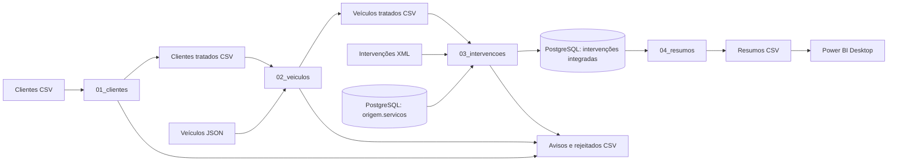

# Integração e validação de dados de uma oficina automóvel

**Trabalho Prático I — Integração de Sistemas de Informação**  
Licenciatura em Engenharia de Sistemas Informáticos · 2026/27

**Autor:** Hugo Carvalho · **Número:** 31519 · Trabalho individual  
**Repositório:** [Hugo31519/ISI](https://github.com/Hugo31519/ISI)

| Material | Localização / estado |
|---|---|
| Relatório em PDF | [31519_doc.pdf](docs/31519_doc.pdf) |
| Relatório editável em Word | [31519_doc.docx](docs/31519_doc.docx) |
| Vídeo de demonstração | [Ver vídeo no YouTube](https://youtu.be/bRhBE6gT9Bc) |
| QR Code do vídeo | Incluído no relatório, na secção Vídeo de demonstração |
| Relatório visual Power BI | [tabela_dashboard.pbix](dashboard/tabela_dashboard.pbix) |

## Sobre o projeto

Uma oficina recebe dados de clientes, veículos e intervenções em sistemas separados. Este projeto integra essas fontes, identifica problemas de qualidade e produz custos e indicadores para análise.

O processo ETL em Pentaho Data Integration lê ficheiros CSV, JSON e XML e consulta os preços dos serviços no PostgreSQL. Depois limpa, valida e cruza os dados, calcula custos e grava as intervenções aceites na base de dados. Os avisos e rejeitados são exportados para CSV com motivos. Os resumos mensal e por serviço alimentam o relatório no Power BI Desktop.

Todos os dados são **sintéticos**, incluindo nomes, contactos, matrículas e preços. Não foram recolhidos de uma base pública de pessoas. Os emails são sintéticos e usam `gmail.com`; permanecem os casos de teste de email inválido e vazio. O campo `custo_total` soma horas × tarifa por hora + peças, em euros e **sem IVA**. É o valor calculado da intervenção, que pode servir de base ao montante a cobrar ao cliente; não mede o custo interno da oficina nem comprova faturação ou pagamento. Não existem campos de margem ou lucro.

## Arquitetura



## Tecnologias

| Tecnologia | Utilização |
|---|---|
| Pentaho Data Integration 10.2 — Spoon | Desenvolvimento e execução visual das transformações e jobs |
| Kitchen | Execução de jobs pela linha de comandos e testes |
| Java 17 | Ambiente utilizado para executar o PDI |
| PostgreSQL 17 | Catálogo de serviços e persistência das intervenções aceites |
| pgAdmin 4 | Preparação e consulta da base de dados |
| Power BI Desktop | Indicadores e gráficos a partir dos resumos CSV |
| Git e GitHub | Histórico e disponibilização do projeto |

## Organização dos ficheiros

```text
ISI/
├── README.md
├── Transformacoes/
│   ├── 01_clientes.ktr
│   ├── 02_veiculos.ktr
│   ├── 03_intervencoes.ktr
│   └── 04_resumos.ktr
├── jobs/
│   ├── oficina_etl.kjb
│   └── oficina_etl_TESTE_FALHA.kjb
├── dados/
│   ├── entrada/             Fontes sintéticas CSV, JSON e XML
│   └── saida/               Resultados gerados pelo job
├── sql/
│   └── 01_preparar_bd.sql
├── docs/                    Relatório Word e PDF e imagens
├── dashboard/
│   └── tabela_dashboard.pbix
└── logs/                    Logs gerados durante a execução
```

O Git inclui exemplos CSV em `dados/saida/`, que são atualizados durante a execução. A pasta `logs/` é gerada localmente e está excluída do Git. Manter a estrutura das pastas ao copiar o projeto.

## Processo ETL

| Ficheiro | Operações |
|---|---|
| [01_clientes.ktr](Transformacoes/01_clientes.ktr) | Ler CSV, normalizar nomes/emails, corrigir espaços com regex, remover duplicados por ID, validar emails, exportar avisos e clientes tratados |
| [02_veiculos.ktr](Transformacoes/02_veiculos.ktr) | Ler JSON, normalizar e validar matrículas, procurar clientes com Stream lookup, exportar veículos aceites e rejeitados |
| [03_intervencoes.ktr](Transformacoes/03_intervencoes.ktr) | Ler XML, deduplicar, converter números/datas, validar valores e referências, calcular custos e inserir/atualizar no PostgreSQL |
| [04_resumos.ktr](Transformacoes/04_resumos.ktr) | Consultar resultados, exportar o detalhe das intervenções, agrupar por mês e serviço, calcular somas/médias, ordenar e exportar CSV |
| [oficina_etl.kjb](jobs/oficina_etl.kjb) | Executar as quatro transformações sequencialmente, gerar logs e encaminhar falhas técnicas para registo e Abort job |
| [oficina_etl_TESTE_FALHA.kjb](jobs/oficina_etl_TESTE_FALHA.kjb) | Demonstrar uma falha controlada por ficheiro de transformação inexistente |

## Como executar noutro computador

### 1. Requisitos e obtenção do projeto

Instalar PDI/Spoon, Java compatível e PostgreSQL. O ambiente testado usa PDI 10.2, Java 17 e PostgreSQL 17. O pgAdmin facilita a preparação da base. O Power BI Desktop é necessário apenas para abrir o relatório visual. Não são necessários Python, Docker, Node-RED ou broker MQTT.

Descarregar o repositório ou cloná-lo:

```text
git clone https://github.com/Hugo31519/ISI.git
```

O driver JDBC PostgreSQL deve estar disponível no PDI. Se o teste de ligação indicar que falta `org.postgresql.Driver`, instalar o driver PostgreSQL JDBC compatível na pasta `lib` do PDI e reiniciar o Spoon.

### 2. Preparar a base de dados

No pgAdmin, criar uma base chamada **`oficina_etl`**. Abrir o Query Tool dessa base, carregar [sql/01_preparar_bd.sql](sql/01_preparar_bd.sql) e executar o script completo.

O script cria:

- `origem.servicos`: catálogo dos oito serviços e preços por hora;
- `destino.intervencoes_integradas`: tabela de resultados do ETL;
- `destino.rejeitados`: tabela reservada, não utilizada pelo fluxo atual, que exporta rejeitados para CSV.

Esta preparação é feita **antes da primeira execução** numa base nova. O job não executa o SQL automaticamente. Numa base já preparada não é necessário repetir o script antes de cada execução. Se repetido, não elimina intervenções existentes, mas repõe os preços e descrições definidos para o catálogo.

Verificar os serviços:

```sql
SELECT codigo_servico, descricao, preco_hora
FROM origem.servicos
ORDER BY codigo_servico;
```

### 3. Configurar as ligações no Spoon

Abrir `03_intervencoes.ktr` e editar a ligação **PostgreSQL Oficina**, através do bloco `Ler serviços PostgreSQL`. Repetir em `04_resumos.ktr`, no bloco `Ler intervenções para análise`: as duas transformações guardam configurações de ligação próprias.

| Campo | Valor |
|---|---|
| Tipo | PostgreSQL |
| Acesso | Native (JDBC) |
| Host | `localhost`, ou endereço do servidor utilizado |
| Base de dados | `oficina_etl` |
| Porta | `5432`, ou a configurada no servidor |
| Utilizador / palavra-passe | Credenciais locais com permissões de leitura em origem e leitura/escrita em destino |

Usar **Test** e guardar as duas transformações após ligação bem-sucedida. Não é necessária a palavra-passe do autor; usar as credenciais do computador onde o projeto será executado. Não publicar palavras-passe pessoais no Git.

### 4. Executar o job

Fechar os CSV de saída no Excel/WPS, pois podem bloquear a escrita. No Spoon, abrir `jobs/oficina_etl.kjb` e carregar em **Run**.

```text
START → 01_clientes → 02_veiculos → 03_intervencoes → 04_resumos → ETL concluído
```

Não é necessário iniciar as transformações individualmente. A sequência garante que os ficheiros tratados existem antes de serem lidos pela etapa seguinte.

Os KTR usam `${Internal.Transformation.Filename.Directory}/../dados/...`. Os jobs usam `${Internal.Job.Filename.Directory}/../Transformacoes/...` e `../logs/...`. Assim, não é necessário alterar os caminhos de dados no Spoon quando a pasta é copiada para outra localização, desde que a estrutura seja mantida.

Cada etapa produz um log individual. O ramo de sucesso avança para a próxima transformação; uma falha técnica segue para `Registar falha do ETL` e `Terminar com erro`. As rejeições de dados previstas são tratadas dentro das transformações.

Alternativa pela linha de comandos do Windows, substituindo os caminhos:

```cmd
"C:\caminho\data-integration\Kitchen.bat" /file:"C:\caminho\ISI\jobs\oficina_etl.kjb" /level:Basic
```

### 5. Verificar a carga e a reexecução

No pgAdmin:

```sql
SELECT COUNT(*) AS total_intervencoes,
       COUNT(DISTINCT id_intervencao) AS ids_distintos,
       SUM(custo_total) AS custo_total
FROM destino.intervencoes_integradas;
```

Com as fontes fornecidas, o resultado esperado é **140 intervenções, 140 IDs distintos e 21 187,15 EUR**. Repetir o job mantém a contagem em 140: o Insert/Update usa `id_intervencao` como chave.

A operação insere/atualiza; não apaga automaticamente resultados antigos se forem removidas ou invalidadas intervenções nas fontes. Para reproduzir os números de referência, usar uma base nova e os dados fornecidos.

### 6. Abrir o relatório Power BI

Executar primeiro o job, que gera `dados/saida/resumo_mensal.csv` e `dados/saida/resumo_servicos.csv`. Abrir [dashboard/tabela_dashboard.pbix](dashboard/tabela_dashboard.pbix).

Noutro computador, ajustar as **duas fontes CSV** em **Transformar dados → Definições da origem de dados → Alterar origem**, ou na engrenagem do passo **Origem** de cada consulta. Apontar para os ficheiros gerados na cópia local. Os caminhos do Power BI são independentes das variáveis do Spoon.

Manter UTF-8, delimitador `;` e conversão numérica com região **Inglês (Estados Unidos)**, porque os ficheiros usam ponto decimal. Aplicar e atualizar os dados. Não é necessário publicar online.

O relatório apresenta quatro indicadores gerais e gráficos de custos por mês, quantidade de intervenções por serviço e custo total por serviço. Os resumos representam janeiro a setembro de 2026 e excluem nomes, contactos e matrículas. Esta exclusão nos agregados não corresponde a hashing ou pseudonimização dos clientes.

## Resultados e regras

| Entidade | Entrada | Resultado |
|---|---|---|
| Clientes | 31 registos, incluindo um duplicado | 30 clientes e 2 avisos de email |
| Veículos | 45 | 43 aceites; 1 rejeitado por matrícula e 1 por cliente inexistente |
| Intervenções | 151 registos, incluindo um duplicado | 150 IDs distintos; 140 aceites e 10 rejeitados |
| Serviços PostgreSQL | 8 | Catálogo de descrição e preço por hora |
| Resumo mensal | 140 intervenções | 9 meses |
| Resumo por serviço | 140 intervenções | 8 serviços |

As 10 intervenções rejeitadas distribuem-se pela ordem de validação: **2 por horas, 1 por custo, 1 por data, 5 por veículo e 1 por serviço**. Cada registo sai no primeiro controlo que falha; o fluxo não enumera todos os erros possíveis numa linha.

- Email ausente ou inválido gera aviso e fica nulo; o cliente é mantido.
- Matrículas seguem o formato do cenário `^[A-Z]{2}-[0-9]{2}-[A-Z]{2}$`, não todos os formatos históricos portugueses.
- A regex de email verifica formato, não a existência da caixa de correio.
- Datas `yyyy-MM-dd` e `dd/MM/yyyy` são uniformizadas e convertidas com validação estrita.
- Horas devem ser maiores que zero; custo de peças deve ser maior ou igual a zero.
- Veículo e serviço devem existir nas referências válidas.
- Custo de mão de obra = horas × preço por hora; custo total = mão de obra + peças.

Os dois resumos reconciliam **140 intervenções, 222,50 horas, 14 109,65 EUR em peças e 21 187,15 EUR de custo total**.

## Consulta das intervenções detalhadas

A tabela `destino.intervencoes_integradas` guarda cada intervenção com o proprietário, veículo, serviço e total. A transformação `04_resumos.ktr` exporta automaticamente `dados/saida/intervencoes_detalhadas.csv`, com 140 linhas ordenadas por data e identificador.

O CSV contém os identificadores, data, matrícula, marca/modelo, nome e email disponível do cliente, descrição do serviço, horas, tarifa por hora, peças, valor de mão de obra e `custo_total`. Os emails inválidos ou ausentes ficam vazios. A soma do detalhe é 21 187,15 EUR, igual à dos dois resumos.

Consulta equivalente no pgAdmin:

```sql
SELECT id_intervencao, data_intervencao, nome_cliente, email,
       matricula, marca, modelo, descricao_servico,
       horas_trabalho, preco_hora, custo_pecas, custo_total
FROM destino.intervencoes_integradas
ORDER BY data_intervencao, id_intervencao;
```

O nome técnico `custo_total` foi mantido para compatibilidade com o esquema e o PBIX. A fórmula calcula o valor da intervenção pela tarifa do serviço e peças; não permite apurar o custo operacional ou lucro da oficina. Não há um valor faturado separado nem registo de pagamento.

## Testes de execução

O job principal foi executado com sucesso, verificando-se as contagens e a correspondência dos totais dos dois resumos. A reexecução sem duplicação foi confirmada.

Para demonstrar uma falha técnica, abrir `jobs/oficina_etl_TESTE_FALHA.kjb`. A entrada `01_clientes` aponta deliberadamente para `INEXISTENTE_TESTE_FALHA.ktr`. Nenhuma transformação real é executada: a tentativa falha, passa pelo registo da falha e termina no Abort com `result=[false]`. O job principal não é alterado por este teste.

Os logs são gerados localmente em `logs/` e não estão versionados.

## Relatório e vídeo de demonstração

O relatório em Word e PDF encontra-se em `docs/`. Inclui capa, índices, arquitetura, transformações, jobs, resultados, imagens, referências e a conclusão como ponto 9. As instruções de execução ficam neste README. A secção Vídeo de demonstração inclui o link e o QR Code do vídeo.

**Link do vídeo de demonstração:** [YouTube — TP01 ISI](https://youtu.be/bRhBE6gT9Bc)

Confirmar que o link do vídeo permite acesso ao docente antes da entrega.

**Hugo Carvalho · nº 31519**  
Integração de Sistemas de Informação · LESI · 2026/27

## Entrega na plataforma

A submissão é um ficheiro **31519.zip**, com uma pasta `tp01-31519/`. O PDF encontra-se em `doc/31519_doc.pdf` dentro do ZIP. Incluem-se também o Word, as quatro transformações, os dois jobs, as fontes de dados, exemplos dos CSV de saída, o SQL e o PBIX.

Mantêm-se os nomes das pastas `Transformacoes/`, `jobs/` e `dados/` para preservar os caminhos relativos do Spoon. A estrutura indicada pelo docente é uma sugestão. O ZIP não inclui a pasta interna `.git`, backups ou scripts auxiliares de preparação do relatório. O endereço do repositório fica identificado neste README e no relatório.

No GitHub e na cópia de entrega, as palavras-passe das ligações PostgreSQL estão vazias; o destinatário configura as suas credenciais nas duas transformações, como explicado acima. A configuração de trabalho local mantém-se. O link do vídeo e o QR Code estão incluídos no README e no relatório, e o ZIP contém as versões atualizadas.
